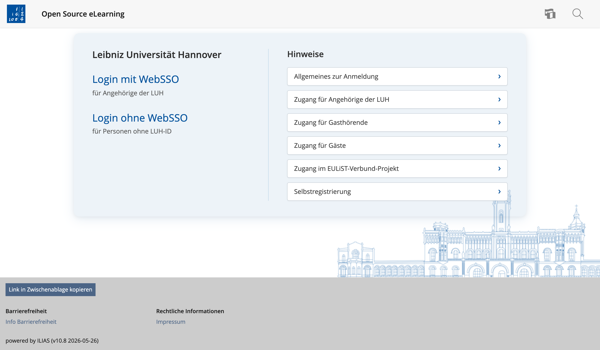

# LUH-Skin

Dieser Skin wurde dem [LUH-Stil](https://www.uni-hannover.de/) entsprechend angepasst.

---

## Version
v2.4.2 — für **ILIAS 10** <!-- x-release-please-version -->

**Kompiliert gegen ILIAS `v10.12`.**

Die ausgelieferte `LUH-Style/LUH-Style.css` **enthält die delos-Basis genau dieser
ILIAS-Version** – der Skin wird vorkompiliert aus Git deployt (siehe
[Empfehlung / Deployment](#-empfehlung--deployment)). Auf einem **neueren** ILIAS fehlen
dadurch die Regeln für Komponenten, die ILIAS seitdem hinzugefügt hat: Diese Elemente
werden dann **unstyled** dargestellt, ohne dass eine Fehlermeldung erscheint. Nach einem
ILIAS-Update daher `./update-skin.sh prod` ausführen und die neue CSS mitcommitten.

> Die Angabe wird von `update-skin.sh` automatisch aus `ilias_version.php` der
> ILIAS-Installation ermittelt und in [`ILIAS_BUILD_VERSION`](ILIAS_BUILD_VERSION)
> geschrieben; die **ILIAS Version Guard**-CI stellt sicher, dass diese README-Angabe
> nicht davon abweicht.

> Der ILIAS-9-Stand bleibt auf den `v1.x`-Tags erhalten (zuletzt `v1.3.0`).

* [CHANGELOG](CHANGELOG.md)

---

## 📸 Screenshot


*LUH-Login auf ILIAS 10.12*

---

## 🧭 Loginmaske

Die Loginmaske (`components/ILIAS/Init/tpl.login.html`) besteht aus zwei Spalten:

* **links** die beiden Anmeldewege – »Login mit WebSSO« (nur sichtbar, wenn Shibboleth
  aktiv ist, siehe `tpl.login_form_shibboleth.html`) und »Login ohne WebSSO«;
* **rechts** die **Hinweise** als Akkordeon mit sechs Fächern: Allgemeines zur Anmeldung,
  Zugang für Angehörige der LUH, für Gasthörende, für Gäste, im EULiST-Verbund-Projekt
  und Selbstregistrierung.

Die Fächer folgen dem WAI-ARIA-Accordion-Pattern (`h3 > button`, `aria-expanded`,
`aria-controls`, Panel als benannte `region`) und lassen sich **unabhängig voneinander**
öffnen. Ohne JavaScript werden über einen `<noscript>`-Block alle Fächer ausgeklappt,
damit die Anmeldehinweise nie hinter funktionslosen Schaltflächen verschwinden.

### Zweisprachigkeit

Der Skin enthält **keine** ILIAS-Sprachdateien – eigene Sprachvariablen lägen in der
ILIAS-Datenbank und wären damit nicht mehr Teil dieses aus Git deployten Skins. Deutsche
und englische Texte stehen deshalb **beide** im Template und sind mit
`data-luh-i18n="de"` bzw. `data-luh-i18n="en"` ausgezeichnet. `_login.scss` blendet über
`html:lang()` die passende Variante ein; **Deutsch ist der Fallback** für alle Sprachen
außer Englisch.

> Beim Ändern der Texte immer **beide** Sprachfassungen pflegen.

---

## 📁 Installation

### Schritt 1: Zur ILIAS-Root-Installation wechseln

> **ILIAS 10:** Der Skin liegt jetzt unter `public/Customizing/skin/` – das
> Segment `global` aus ILIAS 9 entfällt.

```bash
cd /srv/ilias-luh/ILIAS/
cd public/Customizing/
```

### Schritt 2: Ordner "skin" anlegen (falls nicht vorhanden)

```bash
mkdir skin
cd skin
```

### Schritt 3: LUH-Skin klonen

```bash
git clone https://github.com/iFadi/LUH-Skin.git
cd LUH-Skin
```

### Schritt 4: Branch oder Tag auswählen

Beispiel für einen stabilen Release-Tag:

```bash
git checkout tags/v2.4.2   # x-release-please-version
```

Falls du dich auf dem `main`-Branch befindest, kannst du einfach ein Pull durchführen:

```bash
git pull
```

✅ Das war's – der Skin ist installiert.

> **Hinweis (Registrierungs-Patch):** Der Skin enthält unter
> `components/ILIAS/Registration/` eine angepasste ILIAS-Kernklasse
> (`class.ilAccountRegistrationGUI.php`), die zusätzlich Benutzernamen im
> Format `XXX-XXX` ablehnt. Diese Datei ist **kein** Skin-Override, sondern ein
> Kern-Patch und muss manuell kopiert sowie bei jedem ILIAS-Update neu aus der
> Kernklasse abgeleitet werden – siehe
> [components/ILIAS/Registration/README.md](components/ILIAS/Registration/README.md).

---

## 🔧 Für die Implementierung

Zur Anpassung des Skins müssen die `.scss`-Dateien bearbeitet werden. Anschließend ist das Skript `update-skin.sh` auszuführen, um die **SCSS-Dateien zu kompilieren**.

**Wichtig:** Das Skript importiert die ILIAS-Basis (`delos`) über einen relativen Pfad
(`@use ".../templates/default/delos"`). SCSS-`@use`-Pfade sind statisch – der `dev`-/Base-Path-Parameter
ändert nur die **Font-/Bild-URLs**, nicht diesen Import. Daher gibt es zwei Wege:

**A) Innerhalb einer ILIAS-Installation (Standard, z. B. Produktiv-/Testsystem):**
Der Skin liegt unter `public/Customizing/skin/luh/`, der relative Pfad löst sich automatisch auf.

```bash
./update-skin.sh prod
```

**B) Standalone / lokal (Skin-Klon ohne ILIAS drumherum):**
Den Pfad zur ILIAS-Wurzel (Ordner mit `templates/default/`) per 3. Argument **oder** `ILIAS_ROOT` angeben:

```bash
# z. B. templates aus einem laufenden ILIAS-10-Container holen:
docker cp ilias10:/var/www/html/templates /pfad/zu/ilias10/templates

# ilias_version.php gleich mitkopieren: daraus liest update-skin.sh die ILIAS-Version
# und schreibt sie nach ILIAS_BUILD_VERSION. Fehlt die Datei, warnt das Skript und
# lässt ILIAS_BUILD_VERSION unverändert — die Angabe muss dann von Hand stimmen.
docker cp ilias10:/var/www/html/ilias_version.php /pfad/zu/ilias10/ilias_version.php

ILIAS_ROOT=/pfad/zu/ilias10 ./update-skin.sh prod
# oder:  ./update-skin.sh prod "" /pfad/zu/ilias10
```

### 📌 Hinweise:

* Das Skript verwendet die **Systemzeit**, um die generierten CSS-Dateien mit einer **eindeutigen ID** zu versehen.
* Diese ID wird an den Hauptdateinamen `LUH-Style.css` angehängt. → Dadurch wird ein **automatisches Neuladen im Browser** erzwungen (Cache-Busting).
* Sollte auf dem produktiven System `dart-sass` **nicht installiert** sein, kann das Skript **nicht ausgeführt** werden.

### 🗺️ Source Maps

`prod` kompiliert mit `--no-source-map`, `dev` erzeugt weiterhin eine `LUH-Style.css.map`.

Die Map wird **nicht eingecheckt** (siehe `.gitignore`) und gehört nicht auf den Server:
Ihr `sources`-Array enthält **absolute Pfade des Build-Rechners** – beim Standalone-Build
zusätzlich der umgeschriebene `delos`-Pfad. Eingecheckt würde sie öffentlich neben der CSS
ausgeliefert, die lokale Verzeichnisstruktur preisgeben und bei jedem Build auf einem
anderen Rechner einen ~150 KB großen Diff erzeugen.

### 💡 Empfehlung / Deployment:

Auf dem **Produktivsystem ist `dart-sass` nicht installiert** – dort wird also nie kompiliert.
Der Skin wird **vorkompiliert aus Git deployt**: Die `LUH-Style.css` wird auf einem
**Testsystem** (z. B. mit definierter Tag-/Skin-Version) mit `./update-skin.sh prod` gebaut,
**mitsamt der neuen Version-ID in `template.xml` committet** und anschließend auf dem
Produktivsystem ausgecheckt.

> ⚠️ Ein Commit, der `.scss` ändert, muss daher **immer die neu kompilierte `LUH-Style.css`
> enthalten** – sonst geht die Änderung auf dem Produktivsystem verloren.

---

## 🚀 Release-Prozess

Releases werden **nicht mehr von Hand getaggt**. Den Ablauf übernimmt
[release-please](https://github.com/googleapis/release-please) über den Workflow
`.github/workflows/release-please.yml`.

1. **Commits nach Conventional Commits** schreiben (`feat:`, `fix:`, `docs:`, `style:` …) –
   der Typ entscheidet, in welchem Abschnitt des Changelogs der Commit landet und ob die
   Minor- oder die Patch-Stelle steigt. `feat!:` bzw. ein `BREAKING CHANGE:`-Footer lösen
   einen Major-Bump aus.
2. Nach jedem Merge auf `main` hält release-please automatisch einen Pull Request
   **»chore(main): release x.y.z«** offen. Dieser PR sammelt alle Änderungen seit dem
   letzten Release und pflegt `CHANGELOG.md`, `version.txt` sowie die Versionsangaben in
   dieser README.
3. **Den Release-PR mergen = releasen.** release-please setzt daraufhin den Tag `vX.Y.Z`
   und erstellt das GitHub-Release mit dem erzeugten Changelog-Abschnitt als Release Notes.

> 🔀 **Pull Requests werden gesquasht** (Merge-Commits und Rebase sind im Repo
> deaktiviert). Der PR-Titel wird zum Commit-Betreff und muss deshalb selbst ein
> Conventional Commit sein; die Einzel-Commits bleiben als Body erhalten. Merge-Commits
> führten hier zu doppelten Changelog-Einträgen, weil GitHub den PR-Titel zusätzlich in
> den Merge-Commit schreibt und release-please beide Commits auswertet.

> ℹ️ Die beiden Versionsangaben in dieser README sind mit einem
> `x-release-please`-Kommentar markiert und werden vom Release-PR automatisch
> mitgezogen – die Marker bitte nicht entfernen, sonst veraltet die README wieder.
> (Der Marker wird hier bewusst ohne sein Suffix geschrieben: release-please ersetzt
> die erste Versionsnummer **jeder** Zeile, die den vollständigen Marker enthält –
> auch in erklärendem Fließtext wie diesem.)

> ⚠️ Der Release-PR enthält **nur Changelog- und Versionsdateien**. Eine geänderte
> `.scss` muss weiterhin zusammen mit der neu kompilierten `LUH-Style.css` im jeweiligen
> Feature-PR liegen (siehe [Empfehlung / Deployment](#-empfehlung--deployment)).

---

## ✅ Kompatibilität

Dieses Release ist für **ILIAS v10.x** vorgesehen.

* Für **ILIAS 9** den Tag `v1.3.0` verwenden.

---

## ⚠️ Wartungshinweis

Bei **jedem ILIAS-Update** (Minor- und Major-Versionen) muss:

* der **Skin neu kompiliert** werden
* die **Funktionalität des Skins getestet** werden, um sicherzustellen, dass er weiterhin korrekt dargestellt wird

---
